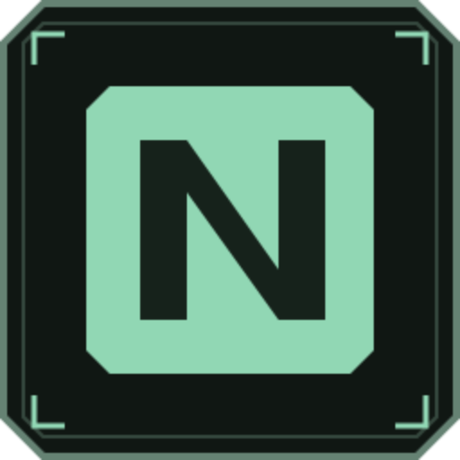

# NEXUS

Дневник здоровья и повседневных дел для Windows и Android. Быстрые записи, понятная динамика и закрытые группы друзей.



## Возможности

- **День:** вес, сон, расходы и еда одним действием. Голосовой рассказ разбирает наставник; сохранённое можно исправить. Дела и уход с отдельными отметками и напоминаниями.
- **Прогресс:** графики веса, сна, питания, денег и активности. Накопления, приблизительное КБЖУ и витамины, распознавание еды и этикеток. Линии продолжаются последним известным значением; расчёты используют реальные записи.
- **Друзья:** закрытые группы по коду, рейтинг регулярности, общий челлендж и поддержка одним нажатием. Вес и тренировки открывает сам участник. Дневник, питание по приёмам, лекарства и деньги остаются личными.
- **Быстрый ввод:** компактное окно Windows по Ctrl+Shift+Пробел или через трей; виджет Android с весом, голосом и расходом. Числа сохраняются без обращения к ИИ.
- **Интерфейс:** графит и зелёный акцент, короткий отклик на сохранение и завершение дня. Анимации, вибрация, звук и подробная статистика настраиваются. Работа и инвестиции подключаются отдельно.

Прежняя история сохраняется в расширенных разделах. Данные нового ежедневного интерфейса используют отдельное хранилище прежнего режима фокуса. Перенос в основную историю выполняется только кнопкой в настройках. У каждого пользователя своя база и персональный ключ OpenRouter с ограничением расходов.

## Установка

Готовые сборки размещаются в [Releases](https://github.com/CaptainReinor/nexus/releases). Windows: запустить установщик. Android: установить APK. Linux: разрешить выполнение файла AppImage и запустить его без установки. Текущая версия Windows и Android: **0.9.1**. Linux сохраняет прежнюю сборку; этот выпуск её не обновляет. [Запуск на Linux](docs/linux.md). [Обновления приложения](docs/updates.md).

При первом запуске введите код доступа. Адрес сервера уже настроен; приглашение выдаёт владелец NEXUS. Доступ к чужим данным код не предоставляет. На новом аккаунте сразу есть счёт «Дебет» и девять категорий расходов.

Для собственной установки сервера измените `defaultServerEndpoint` в `NEXUS/src/shared/accounts.ts` перед сборкой приложений. Windows и Linux также могут работать без сервера, если закрыть окно входа.

Для обновления установить новую версию поверх прежней. Перед экспериментами с базой сделайте экспорт в настройках.

## Структура репозитория

```text
NEXUS/            Windows и Linux: Electron, React, SQLite и общие модули
NEXUS-Android/    Android: React, Capacitor, нативный AI-клиент
nexus_backup.py   HTTPS API синхронизации и копий
accounts.py       Изоляция серверных профилей и приглашения
social.py         Закрытые группы, рейтинг и общие цели
install_vps.py    Установка службы с явными параметрами nginx
deploy/           Обновление серверного кода с откатом
docs/             Архитектура и установка сервера
```

Серверные файлы сохраняют прежние пути в корне: существующие ссылки на `raw.githubusercontent.com/.../main/nexus_backup.py` остаются действительными. Для обновления следует загружать серверные модули через подготовленный обновляющий скрипт.

## Разработка

Нужны Node.js 24; для Android дополнительно JDK 21 и Android SDK. Запускайте команды из соответствующей папки. Lock-файлы включены.

### Windows и Linux

```powershell
cd NEXUS
npm ci
npm ci --prefix ../NEXUS-Android --ignore-scripts
npm run typecheck
npm run lint
npm test
npm run dev
```

Для установщика: `npm run dist:win`. Нативный `better-sqlite3` должен соответствовать Electron; скрипт сборки использует бинарный модуль зависимости. На нестандартной системе может понадобиться сборка нативного модуля.

### Android

```powershell
cd NEXUS-Android
npm ci
npm ci --prefix ../NEXUS --ignore-scripts
npm run android:apk
```

Задайте `JAVA_HOME` и `ANDROID_HOME` либо настройте Android Studio. `android/local.properties` и ключи подписи не включаются в Git. Debug APK предназначен для тестирования; для распространения с постоянной подписью используйте собственный закрытый ключ. Его нельзя публиковать.

Общие компоненты и межплатформенные тесты используют зависимости соседнего приложения. Поэтому в командах выше устанавливаются оба набора; для соседней папки достаточно `--ignore-scripts`, без сборки её нативных модулей.

### Серверные тесты

```sh
python3 -m unittest -q test_nexus_backup test_accounts
```

[Установка и обновление сервера](docs/server.md) · [Архитектура](docs/architecture.md) · [Безопасность](SECURITY.md)

## Работа с обновлениями

Изменения проверяются в GitHub Actions. Публикация исходников не обновляет рабочий VPS: сервер обновляется отдельной командой по выбранному коммиту. Обновляющий скрипт сохраняет старый код, проверяет новую версию, перезапускает только службу NEXUS и возвращает старый код при неудачной проверке. Он не меняет nginx, базу и ключи.

## Лицензия

Код — MIT. Лицензии сторонних зависимостей остаются за их авторами. Сторонние изображения и шрифты не распространяются под MIT; происхождение графики описано в [ресурсах дизайна](docs/design/dominion/resources.json) и [уведомлении об арте](NEXUS/src/renderer/assets/THIRD-PARTY-ART.md).


«На сегодня» настраивается кнопкой внутри блока. По умолчанию остаются вес и сон; можно выбрать другие пункты или снять все. В настройках есть «Сбросить записи»: после подтверждения очищается текущий дневник и его статистика. Цели, настройки, приглашение, дела, уход и прежняя история сохраняются. Перед сбросом обновите оба устройства до 0.9.1: сервер не принимает записи от старых клиентов после сброса этого аккаунта.
